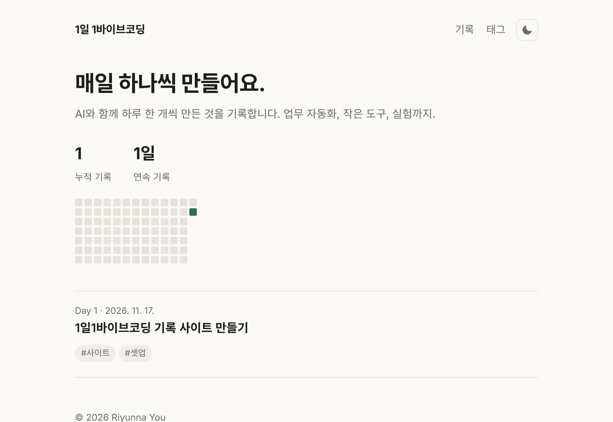

## 오늘 만든 것
Day 1의 "다음에 해볼 것" 두 개를 바로 해치웠다.

- **다크모드 토글**: 오른쪽 위 버튼으로 라이트/다크를 전환한다. 고른 값은 브라우저에 저장돼서 새로고침하거나 다른 글로 이동해도 유지된다. 고른 적이 없으면 기기(시스템) 설정을 따른다.
- **글에 스크린샷 넣기**: 머리말의 `cover`에 이미지를 지정하면 글 상단에 대표 이미지가 붙고, 홈 목록에도 썸네일이 뜬다. 본문에는 마크다운 이미지 문법으로 넣으면 된다.

*라이트 모드 — 맨 위 대표 이미지가 다크 모드. 버튼 아이콘이 달 ↔ 해로 바뀐다*

## 프롬프트·과정
> 다크모드 토글 + 글 스크린샷 넣기

- 기존에는 CSS `prefers-color-scheme`으로 시스템 설정만 따랐는데, `html`에 `data-theme` 속성을 붙이는 방식으로 바꿔서 직접 고를 수 있게 했다.
- 테마를 정하는 스크립트를 `<head>` 안에서 먼저 실행해서, 페이지를 열 때 흰 화면이 번쩍이는 현상(FOUC)을 막았다.
- 이미지는 `src/content/logs/images/`에 두면 Astro가 빌드할 때 알아서 크기를 줄이고 webp로 바꿔준다.

## 막힌 점
- 같은 날 글이 두 개가 되면서 Day 번호 순서가 섞일 수 있었다. 날짜가 같으면 파일 이름순으로 정렬하도록 고쳤다 (`2026-11-17.md` → `2026-11-17-2.md`).

## 다음에 해볼 것
- 업무용 도구 만들기 시작: 리다이렉트 URL 정리기
